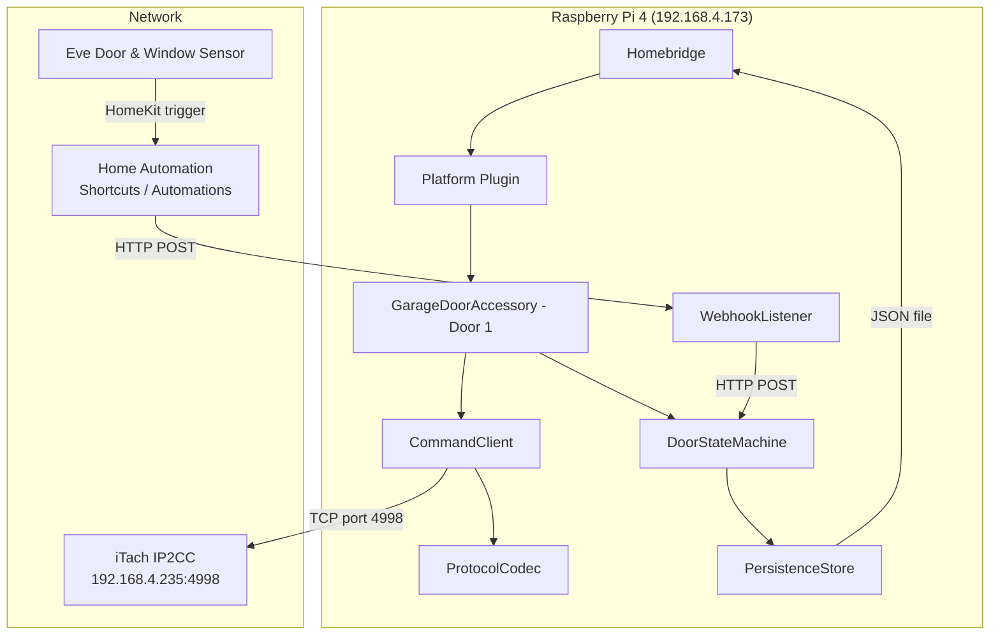
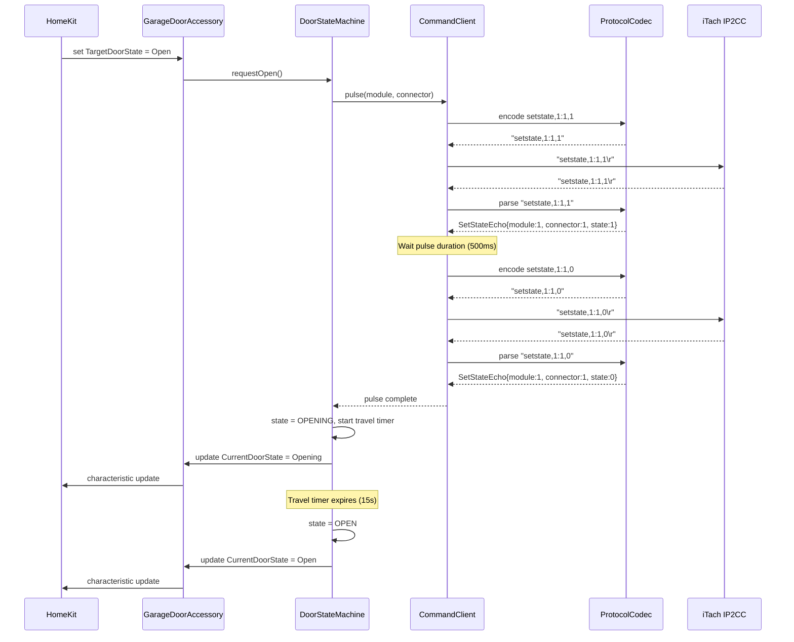
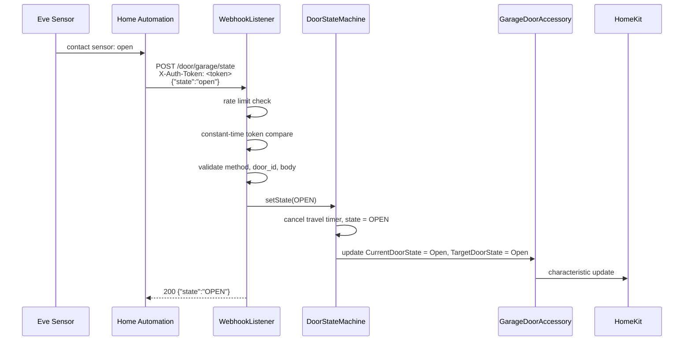
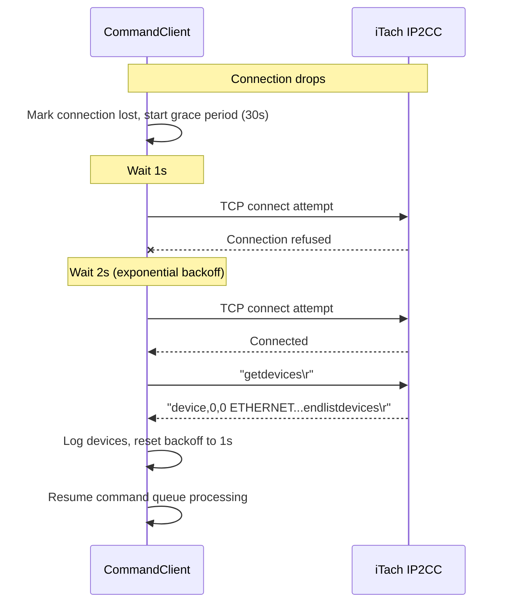
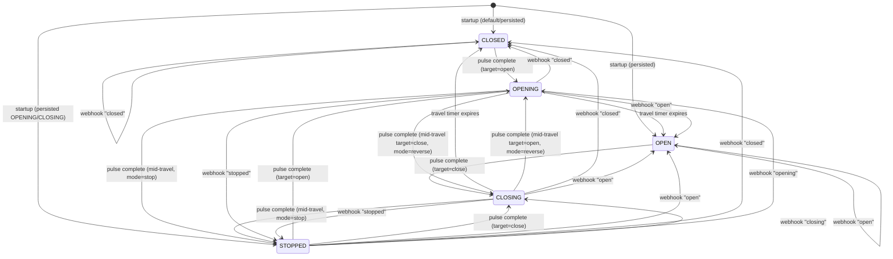

# Design Document: iTach Garage Door Plugin

## Overview

This document describes the technical design of `homebridge-itach-garage-door`, a Homebridge dynamic platform plugin that exposes one or more garage doors as HomeKit `GarageDoorOpener` accessories. Each door is actuated by pulsing a relay connector on a Global Caché iTach IP2CC device over TCP, and the door's state is inferred by timers and optionally corrected by an external HTTP webhook (driven by an Eve Door & Window sensor automation).

The plugin runs on a Raspberry Pi 4 (64-bit Raspberry Pi OS, Node.js 20 LTS) alongside the existing Homebridge installation. It uses only Node.js built-in modules (`net`, `http`, `fs`, `path`, `crypto`, `timers`) — no heavy frameworks, no native addons.

### Key Design Decisions

| Decision | Rationale |
|----------|-----------|
| Dynamic platform plugin | Supports multiple doors, cached accessories across restarts |
| Single TCP connection per IP2CC address:port | Avoids connection exhaustion, simplifies command queuing |
| `\r`-delimited stream parsing | Matches observed IP2CC behaviour — responses arrive concatenated, separated by `\r` only |
| Timer-inferred state (not polled) | IP2CC has no door position sensor; Eve sensor is HomeKit-only, unreadable by Homebridge |
| Webhook for state correction | Bridges the gap — Home automation triggers HTTP POST when Eve sensor state changes |
| State persistence via JSON file | Survives Homebridge restarts without losing door position |
| Constant-time token comparison | Prevents timing attacks on the webhook authentication |
| No runtime native dependencies | Installs cleanly on aarch64 without a compiler toolchain |

---

## Architecture



### Data Flow — Open Door Command



### Data Flow — Webhook State Correction



### Data Flow — Reconnection After TCP Failure



---

## Components and Interfaces

### 1. Platform (`ItachGarageDoorPlatform`)

The top-level Homebridge dynamic platform plugin. Responsibilities:
- Register the platform name with Homebridge
- Validate configuration and log errors
- Create/restore/unregister accessories
- Instantiate shared `CommandClient` instances (one per IP2CC address:port)
- Start and stop the `WebhookListener`
- Orchestrate graceful shutdown

```typescript
class ItachGarageDoorPlatform implements DynamicPlatformPlugin {
  readonly accessories: PlatformAccessory[] = [];

  constructor(log: Logger, config: PlatformConfig, api: API);

  configureAccessory(accessory: PlatformAccessory): void;  // cached accessory restore
  discoverDevices(): void;                                  // called on didFinishLaunching
  shutdown(): void;                                         // called on shutdown signal
}
```

### 2. Accessory Handler (`GarageDoorAccessory`)

Binds a single `PlatformAccessory` to its `DoorStateMachine` and `CommandClient`. Registers characteristic handlers.

```typescript
class GarageDoorAccessory {
  constructor(
    platform: ItachGarageDoorPlatform,
    accessory: PlatformAccessory,
    config: ValidatedDoorEntry,
    stateMachine: DoorStateMachine,
    commandClient: CommandClient,
  );

  // HomeKit characteristic handlers
  handleTargetDoorStateSet(value: CharacteristicValue): Promise<void>;
  handleCurrentDoorStateGet(): CharacteristicValue;
  handleObstructionDetectedGet(): boolean;
}
```

### 3. Command Client (`CommandClient`)

Owns one TCP connection per IP2CC address:port pair. Serialises commands, handles reconnection with exponential backoff, manages a 16-deep FIFO queue.

```typescript
interface CommandResult {
  readonly raw: string;
}

interface StateResponse extends CommandResult {
  readonly type: 'state';
  readonly module: number;
  readonly connector: number;
  readonly value: 0 | 1;
}

interface SetStateEcho extends CommandResult {
  readonly type: 'setstate-echo';
  readonly module: number;
  readonly connector: number;
  readonly value: 0 | 1;
}

interface ErrorResponse extends CommandResult {
  readonly type: 'error';
  readonly code: string;
}

interface DevicesResponse extends CommandResult {
  readonly type: 'devices';
  readonly modules: Array<{ module: number; type: string; connectors: number }>;
}

interface ParseError extends CommandResult {
  readonly type: 'parse-error';
}

type Response = StateResponse | SetStateEcho | ErrorResponse | DevicesResponse | ParseError;

class CommandClient {
  constructor(
    host: string,
    port: number,
    codec: ProtocolCodec,
    log: Logger,
  );

  sendCommand(command: string): Promise<Response>;
  connect(): Promise<void>;
  disconnect(): Promise<void>;
  readonly isConnected: boolean;
  readonly connectionLostAt: number | null;
}
```

### 4. Protocol Codec (`ProtocolCodec`)

Pure, stateless module. Encodes commands to wire format and parses response strings into typed results. Handles the observed protocol quirks:
- Responses arrive concatenated, delimited by `\r` (not `\n`)
- `setstate` commands echo the command name back (e.g., `setstate,1:1,1`) rather than a `state,...` response
- `getdevices` response is a multi-part concatenated block ending with `endlistdevices`

```typescript
class ProtocolCodec {
  // Encoding
  encodeSetState(module: number, connector: number, state: 0 | 1): string;
  encodeGetState(module: number, connector: number): string;
  encodeGetDevices(): string;

  // Parsing (single response frame, already split on \r)
  parseResponse(raw: string): Response;

  // Stream splitting — extracts complete frames from accumulated buffer
  extractFrames(buffer: string): { frames: string[]; remainder: string };
}
```

### 5. Door State Machine (`DoorStateMachine`)

Holds the inferred door state and manages travel timers. Pure logic — no I/O. Emits state-change events consumed by the accessory handler.

```typescript
type DoorState = 'CLOSED' | 'OPEN' | 'OPENING' | 'CLOSING' | 'STOPPED';
type MidTravelBehaviour = 'stop' | 'reverse';

interface DoorStateChangeEvent {
  readonly previous: DoorState;
  readonly current: DoorState;
  readonly trigger: 'homekit' | 'timer' | 'webhook' | 'restore' | 'assumed';
}

class DoorStateMachine extends EventEmitter {
  constructor(config: {
    openingTravelTime: number;   // seconds
    closingTravelTime: number;   // seconds
    midTravelBehaviour: MidTravelBehaviour;
  });

  readonly state: DoorState;
  readonly isTimerRunning: boolean;

  // Transitions triggered by HomeKit
  requestOpen(): 'pulse' | 'no-op';
  requestClose(): 'pulse' | 'no-op';
  pulseCompleted(requestedTarget: 'open' | 'close'): void;
  pulseFailed(): void;

  // Transitions triggered by webhook
  setExternalState(state: DoorState): void;

  // Transitions triggered by timer
  private onTravelTimerExpired(): void;

  // Startup
  restoreState(persisted: DoorState): void;

  // Cleanup
  cancelTimer(): void;
}
```

### State Machine Transitions



### 6. Webhook Listener (`WebhookListener`)

HTTP server on a configurable port. Validates requests in strict order: rate limit → token → method → door ID → body.

```typescript
class WebhookListener {
  constructor(config: {
    port: number;
    bindAddress: string;
    token: string;
    doors: Map<string, DoorStateMachine>;
    log: Logger;
  });

  start(): Promise<void>;
  stop(): Promise<void>;
  readonly isListening: boolean;
}
```

### 7. Persistence Store (`PersistenceStore`)

Reads and writes a JSON file in the Homebridge storage directory. Keyed by `<ip>:<module>:<connector>` to survive config reordering.

```typescript
interface PersistedState {
  [key: string]: DoorState;  // key = "192.168.4.235:1:1"
}

class PersistenceStore {
  constructor(storagePath: string, log: Logger);

  load(): PersistedState;
  save(key: string, state: DoorState): void;
}
```

---

## Data Models

### Configuration Schema (config.schema.json)

```json
{
  "pluginAlias": "ItachGarageDoor",
  "pluginType": "platform",
  "singular": true,
  "headerDisplay": "iTach IP2CC Garage Door Opener",
  "schema": {
    "type": "object",
    "properties": {
      "doors": {
        "title": "Doors",
        "type": "array",
        "maxItems": 8,
        "items": {
          "type": "object",
          "properties": {
            "name": {
              "title": "Display Name",
              "type": "string",
              "minLength": 1,
              "maxLength": 64,
              "required": true
            },
            "ipAddress": {
              "title": "IP2CC IP Address",
              "type": "string",
              "format": "ipv4",
              "required": true
            },
            "relay": {
              "title": "Relay Connector",
              "type": "string",
              "enum": ["1:1", "1:2", "1:3"],
              "required": true
            },
            "port": {
              "title": "TCP Port",
              "type": "integer",
              "minimum": 1,
              "maximum": 65535,
              "default": 4998
            },
            "doorId": {
              "title": "Door ID (for webhook path)",
              "type": "string",
              "pattern": "^[a-z0-9-]{1,64}$"
            },
            "pulseDuration": {
              "title": "Pulse Duration (ms)",
              "type": "integer",
              "minimum": 100,
              "maximum": 2000,
              "default": 500
            },
            "openingTime": {
              "title": "Opening Travel Time (seconds)",
              "type": "integer",
              "minimum": 1,
              "maximum": 120,
              "default": 15
            },
            "closingTime": {
              "title": "Closing Travel Time (seconds)",
              "type": "integer",
              "minimum": 1,
              "maximum": 120,
              "default": 15
            },
            "midTravelBehaviour": {
              "title": "Mid-Travel Behaviour",
              "type": "string",
              "enum": ["stop", "reverse"],
              "default": "stop"
            }
          }
        }
      },
      "webhookPort": {
        "title": "Webhook Port",
        "type": "integer",
        "minimum": 1024,
        "maximum": 65535
      },
      "webhookBindAddress": {
        "title": "Webhook Bind Address",
        "type": "string",
        "format": "ipv4",
        "default": "0.0.0.0"
      },
      "webhookToken": {
        "title": "Webhook Authentication Token",
        "type": "string",
        "minLength": 20,
        "maxLength": 128
      }
    }
  }
}
```

### Validated Door Entry (internal)

```typescript
interface ValidatedDoorEntry {
  readonly name: string;             // 1–64 chars
  readonly ipAddress: string;        // dotted-quad IPv4
  readonly relay: string;            // "1:1" | "1:2" | "1:3"
  readonly port: number;             // 1–65535, default 4998
  readonly doorId: string;           // [a-z0-9-]{1,64}
  readonly pulseDuration: number;    // 100–2000 ms, default 500
  readonly openingTime: number;      // 1–120 s, default 15
  readonly closingTime: number;      // 1–120 s, default 15
  readonly midTravelBehaviour: MidTravelBehaviour;  // default 'stop'
}
```

### Persisted State File

Stored at `<storagePath>/itach-garage-door.state.json`:

```json
{
  "192.168.4.235:1:1": "CLOSED",
  "192.168.4.235:1:2": "OPEN"
}
```

---

## Project Structure

```
homebridge-itach-garage-door/
├── package.json
├── tsconfig.json
├── config.schema.json
├── README.md
├── CHANGELOG.md
├── .eslintrc.json
├── src/
│   ├── index.ts                    # Plugin registration entry point
│   ├── platform.ts                 # ItachGarageDoorPlatform
│   ├── accessory.ts                # GarageDoorAccessory handler
│   ├── command-client.ts           # TCP connection + command queue
│   ├── protocol-codec.ts           # Encode/decode Global Caché protocol
│   ├── door-state-machine.ts       # State machine + travel timers
│   ├── webhook-listener.ts         # HTTP webhook server
│   ├── persistence-store.ts        # State persistence (JSON file)
│   ├── config-validator.ts         # Configuration validation logic
│   ├── rate-limiter.ts             # Per-IP sliding window rate limiter
│   └── types.ts                    # Shared type definitions
├── test/
│   ├── protocol-codec.test.ts      # Unit + property tests for codec
│   ├── protocol-codec.prop.ts      # Property-based tests (fast-check)
│   ├── door-state-machine.test.ts  # Unit + property tests for state machine
│   ├── door-state-machine.prop.ts  # Property-based tests (fast-check)
│   ├── config-validator.test.ts    # Validation logic tests
│   ├── webhook-listener.test.ts    # HTTP handler tests
│   ├── rate-limiter.test.ts        # Rate limiting tests
│   ├── command-client.test.ts      # Mock TCP tests
│   └── persistence-store.test.ts   # File I/O tests
└── dist/                           # Compiled JS output (gitignored)
```

### package.json (key fields)

```json
{
  "name": "homebridge-itach-garage-door",
  "version": "1.0.0",
  "description": "Homebridge plugin for garage door control via Global Caché iTach IP2CC relay",
  "main": "dist/index.js",
  "scripts": {
    "build": "tsc",
    "lint": "eslint src/",
    "test": "vitest run",
    "test:watch": "vitest",
    "prepublishOnly": "npm run build"
  },
  "keywords": ["homebridge-plugin"],
  "engines": {
    "node": ">=20.0.0",
    "homebridge": ">=1.8.0"
  },
  "devDependencies": {
    "typescript": "^5.4",
    "@types/node": "^20",
    "homebridge": "^1.8.0",
    "vitest": "^2.0",
    "fast-check": "^3.19"
  },
  "files": [
    "dist/",
    "config.schema.json",
    "README.md",
    "CHANGELOG.md"
  ]
}
```

---

## Correctness Properties

*A property is a characteristic or behavior that should hold true across all valid executions of a system — essentially, a formal statement about what the system should do. Properties serve as the bridge between human-readable specifications and machine-verifiable correctness guarantees.*

### Property 1: Command Encoding Round-Trip

*For any* valid command structure (setstate with module=1, connector ∈ {1,2,3}, state ∈ {0,1}; or getstate with module=1, connector ∈ {1,2,3}), encoding that command to a string and then parsing the resulting string SHALL yield a value structurally equal to the original command.

Additionally, the encoded string SHALL contain no leading whitespace, no trailing whitespace, no `\n` character, and no `\r` character, and SHALL be terminated with exactly `\r` when sent on the wire.

**Validates: Requirements 4.1, 4.2, 4.5, 3.2**

### Property 2: Response Parsing Round-Trip

*For any* valid structured response value generated over the domain of:
- State responses: module=1, connector ∈ {1,2,3}, value ∈ {0,1}
- SetState echo responses: module=1, connector ∈ {1,2,3}, value ∈ {0,1}
- Error responses: error codes as decimal digit sequences of 1–8 characters
- Devices responses: 1–5 modules each with 1–6 connectors

serialising that response to its wire format and then parsing the result SHALL yield a value structurally equal to the original response.

**Validates: Requirements 4.3, 4.4, 4.6, 4.8**

### Property 3: Parser Total Function (Never Throws)

*For any* string of length 0 to 256 characters drawn from the printable ASCII range (0x20–0x7E) together with `\r` and `\n`, calling `parseResponse` SHALL return either a valid structured result or a `ParseError` value, and SHALL never raise an exception. When the result is a `ParseError`, the `raw` field SHALL contain at most 256 characters.

**Validates: Requirements 4.7, 4.9, 4.10**

### Property 4: State Machine Transition Correctness (Model-Based)

*For any* sequence of valid inputs to a `DoorStateMachine` — drawn from the set {requestOpen, requestClose, pulseCompleted(open), pulseCompleted(close), pulseFailed, setExternalState(s) for s ∈ {OPEN, CLOSED, OPENING, CLOSING, STOPPED}, onTravelTimerExpired} — applied from any valid initial state:

1. **Invariant**: After every input, the machine holds exactly one `DoorState` value from {CLOSED, OPEN, OPENING, CLOSING, STOPPED} and at most one running travel timer.
2. **Timer rule**: A travel timer is running if and only if the state is OPENING or CLOSING.
3. **Idempotent no-ops**: `requestOpen` from OPEN returns 'no-op'; `requestClose` from CLOSED returns 'no-op'. In reverse mode, `requestOpen` during OPENING returns 'no-op'; `requestClose` during CLOSING returns 'no-op'.
4. **Pulse failure preserves state**: After `pulseFailed`, the state is unchanged and any running timer continues.
5. **External state override**: After `setExternalState(s)`, the state equals `s` and any previous timer is cancelled (a new timer starts if `s` is OPENING or CLOSING).

This property should be tested using model-based testing: maintain a simple reference model alongside the real implementation and verify they agree after every generated input.

**Validates: Requirements 6.1–6.11, 7.2–7.6, 7.8, 7.10, 8.2–8.8**

### Property 5: State-to-Characteristic Mapping

*For any* `DoorState` value, the mapping to HomeKit `CurrentDoorState` characteristic SHALL be: CLOSED→0 (Closed), OPEN→1 (Open), OPENING→2 (Opening), CLOSING→3 (Closing), STOPPED→4 (Stopped). The mapping to `TargetDoorState` SHALL be: OPEN and OPENING→0 (Open); CLOSED, CLOSING, and STOPPED→1 (Closed).

**Validates: Requirements 6.10, 7.7, 8.7, 11.8**

### Property 6: Configuration Validation — Ranges and Defaults

*For any* integer value for pulseDuration:
- If the value is in [100, 2000], the validated result SHALL carry that value unchanged.
- If the value is outside [100, 2000], the validated result SHALL carry 500.

*For any* integer value for openingTime or closingTime:
- If the value is in [1, 120], the validated result SHALL carry that value unchanged.
- If the value is outside [1, 120], the validated result SHALL carry 15.

*For any* integer value for port:
- If the value is in [1, 65535], the validated result SHALL carry that value unchanged.
- If the value is outside [1, 65535], the validated result SHALL carry 4998.

*For any* Door_Entry where one numeric field is out of range, the validated result SHALL preserve the configured values of every other field unchanged.

*For any* string tested as a Door_Id:
- If the string matches `[a-z0-9-]{1,64}`, it SHALL be accepted.
- Otherwise it SHALL be rejected.

*For any* string tested as an IPv4 address:
- If the string is four decimal octets (0–255) separated by dots, it SHALL be accepted.
- Otherwise it SHALL be rejected.

**Validates: Requirements 2.2–2.9, 2.12, 2.13, 2.15**

### Property 7: UUID Determinism and Uniqueness

*For any* pair of valid (ipAddress, relay) tuples:
- If the two tuples are identical, the derived UUIDs SHALL be identical (determinism).
- If the two tuples differ in either `ipAddress` or `relay`, the derived UUIDs SHALL differ (uniqueness).

The UUID derivation SHALL depend on no other field of the Door_Entry (changing name, port, timing values, or doorId SHALL NOT change the UUID).

**Validates: Requirements 1.6**

### Property 8: Rate Limiter Correctness

*For any* sequence of (timestamp, sourceIP) request events where timestamps are monotonically non-decreasing:
- The rate limiter SHALL allow the first 10 requests from a given IP within any 1000ms window.
- The 11th and subsequent requests from the same IP within the same window SHALL be rejected (429).
- After the window expires, the next request from that IP starts a new window and SHALL be allowed.
- When 256 distinct IPs are tracked and a request arrives from a 257th IP, the least-recently-active tracked IP SHALL be evicted.

**Validates: Requirements 9.7**

### Property 9: State Restoration Correctness

*For any* persisted `DoorState` value:
- If the value is a terminal state (CLOSED, OPEN, STOPPED), restoration SHALL set the door's state to that value unchanged.
- If the value is OPENING or CLOSING, restoration SHALL set the door's state to STOPPED (safety: no timer resumes across restart).
- If the value is absent or not a valid DoorState string, restoration SHALL set the door's state to CLOSED.

After restoration, `CurrentDoorState` and `TargetDoorState` SHALL be set according to the Property 5 mapping.

**Validates: Requirements 11.4–11.8**

### Property 10: Door Independence (Isolation)

*For any* multi-door configuration (2–8 doors) and any state-changing operation applied to door A (pulse, timer expiry, webhook state set, persistence write):
- The `DoorState` of every other door B SHALL remain unchanged.
- The running Travel_Timer of every other door B SHALL remain unchanged.
- The actuation queue of every other door B SHALL remain unchanged.
- The persisted state entry of every other door B SHALL remain unchanged.

**Validates: Requirements 11.1, 12.1, 12.5**

### Property 11: Webhook Request Validation Pipeline Order

*For any* HTTP request to the webhook endpoint, the response status code SHALL be determined by the first failing validation check in the strict order: rate limit (429) → authentication token (401) → HTTP method (405) → Door_Id lookup (404) → body validation (400). No check later in the sequence SHALL be evaluated once a preceding check has failed.

**Validates: Requirements 9.9**

---

## Error Handling

### Strategy

The plugin uses a **fail-safe, log-and-continue** approach. No single door failure should take down other doors or the plugin itself.

| Error Category | Handling |
|----------------|----------|
| **TCP connection failure** | Exponential backoff reconnection (1s → 60s). Grace period (30s) returns last-known values. After grace period, report communication failure to HomeKit. |
| **Command timeout (3s)** | Close connection, report timeout, flush queue, trigger reconnect. |
| **Relay release failure** | Retry 3× at 500ms intervals. If all fail, lock out door until successful release. Log at error level. |
| **Config validation error** | Skip invalid Door_Entry, log error, continue with valid entries. Apply defaults for out-of-range numeric values. |
| **Persistence write failure** | Retain state in memory, log error, continue operation. Next state change will attempt write again. |
| **Webhook bind failure** | Log error, keep listener stopped, continue publishing accessories without webhook. |
| **Webhook invalid request** | Respond with appropriate HTTP error status (400/401/404/405/429). No state change. |
| **Unexpected exception** | Catch at accessory handler boundary. Log stack trace. Leave door in current state. |

### Graceful Shutdown

On Homebridge shutdown signal, within 5 seconds:
1. Cancel all running travel timers
2. Send `setstate,X:Y,0` for every relay currently at state 1
3. Stop the webhook listener (close listening socket)
4. Close all TCP connections to IP2CC devices
5. Flush any pending persistence writes

### Token Security

- Webhook token is never logged (replaced with `[REDACTED]` placeholder)
- Constant-time comparison via `crypto.timingSafeEqual` prevents timing attacks
- Rate limiting (10 req/s per IP) mitigates brute-force attempts
- Token validated before any state-revealing check (door ID lookup happens after auth)

---

## Testing Strategy

### Testing Approach

The plugin uses a **dual testing approach**:

1. **Property-based tests** (fast-check, ≥100 iterations each): Verify universal correctness properties across generated inputs. Focus on the ProtocolCodec, DoorStateMachine, ConfigValidator, and RateLimiter — the pure logic components.

2. **Unit tests** (vitest): Verify specific examples, edge cases, integration scenarios, and error handling. Focus on the CommandClient (with mock TCP), WebhookListener (with mock HTTP), PersistenceStore (with mock fs), and GarageDoorAccessory (with mock Homebridge API).

### Property-Based Testing Configuration

- **Library**: [fast-check](https://github.com/dubzzz/fast-check) v3.19+
- **Runner**: vitest
- **Iterations**: Minimum 100 per property (default fast-check behaviour)
- **Tag format**: `Feature: itach-garage-door-plugin, Property {number}: {title}`

### Test Coverage Matrix

| Component | Property Tests | Unit Tests | Integration Tests |
|-----------|---------------|------------|-------------------|
| ProtocolCodec | P1, P2, P3 | Encoding examples, edge cases | — |
| DoorStateMachine | P4, P5, P9, P10 | Specific transition sequences | — |
| ConfigValidator | P6, P7 | Specific invalid configs | — |
| RateLimiter | P8 | Window boundary, eviction | — |
| WebhookListener | P11 | Auth, body parsing, obstruction | HTTP request/response |
| CommandClient | — | Timeout, queue overflow, reconnect | Mock TCP server |
| PersistenceStore | — | Read/write, corruption recovery | File I/O |
| Platform | — | Accessory registration, cleanup | Mocked Homebridge API |
| GarageDoorAccessory | — | Characteristic handlers, pulse flow | — |

### Key Test Scenarios (Unit)

1. **Pulse sequence**: setstate 1 → wait → setstate 0, verify timing
2. **Pulse failure on setstate 1**: verify no setstate 0 sent, state unchanged
3. **Relay release retry**: 3 failures then success on setstate 0
4. **Connection loss during pulse**: verify grace period behaviour
5. **Webhook with concurrent pulse**: state applied, pulse completes normally
6. **Config with duplicate Door_Id / duplicate IP+relay**: verify first-wins
7. **Persistence corruption recovery**: invalid JSON → default CLOSED
8. **Shutdown sequence**: timers cancelled, relays released, connections closed

### Dependency Choices

| Dependency | Purpose | Why |
|-----------|---------|-----|
| `net` (built-in) | TCP connection to IP2CC | No external dep needed for raw TCP |
| `http` (built-in) | Webhook listener | Simple HTTP server, no framework needed |
| `fs` (built-in) | State persistence | JSON file read/write |
| `crypto` (built-in) | Constant-time token comparison | `timingSafeEqual` |
| `events` (built-in) | State machine event emitter | Standard Node.js pattern |
| `vitest` (dev) | Test runner | Fast, ESM-native, TypeScript support |
| `fast-check` (dev) | Property-based testing | Best-in-class JS/TS PBT library |
| `typescript` (dev) | Compilation | Type safety during development |

No runtime dependencies beyond Node.js built-ins. Zero native addons. Installs cleanly on aarch64 without a compiler.
